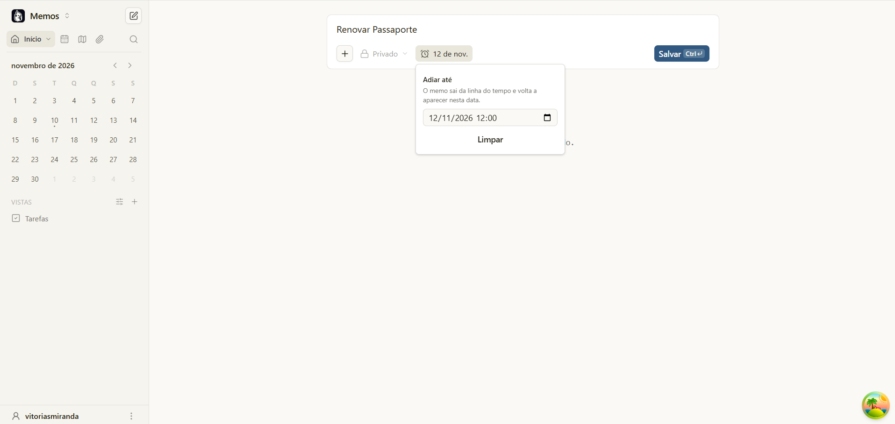
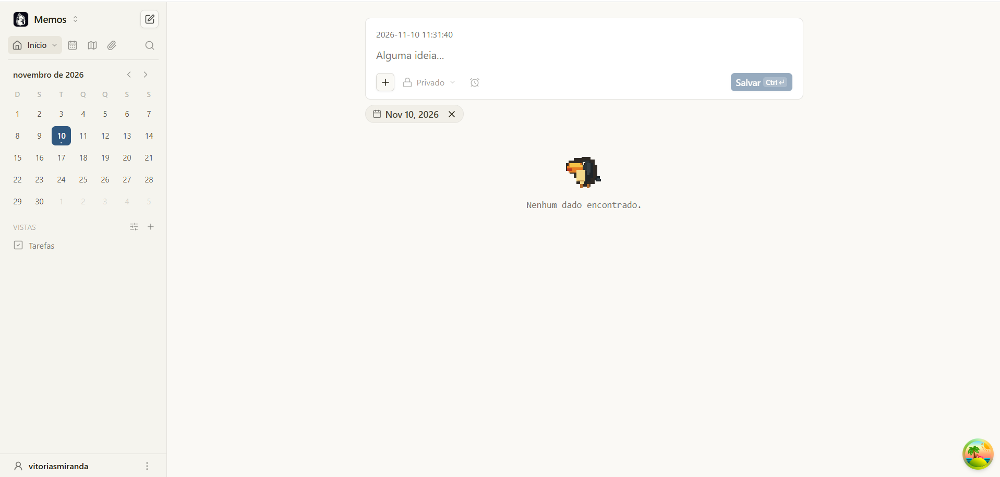
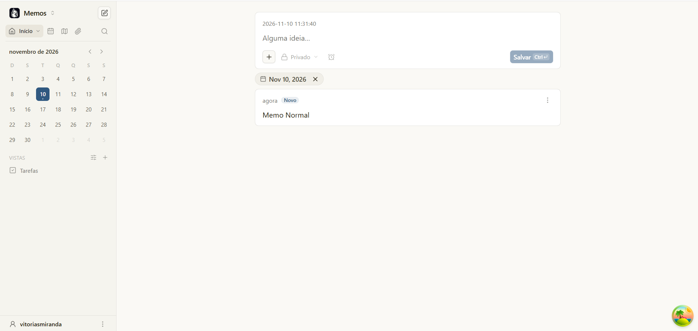
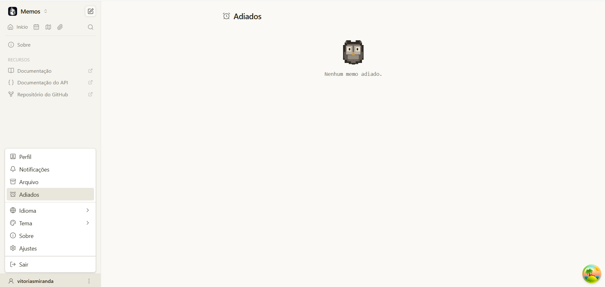
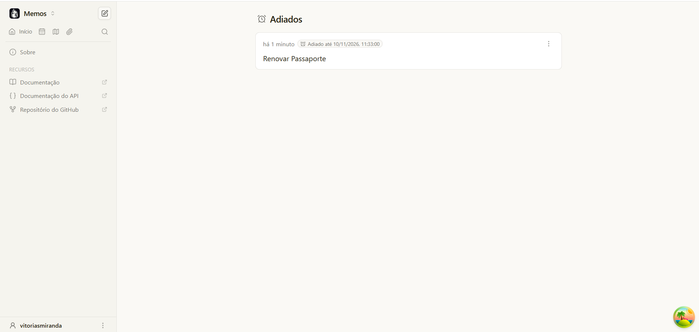
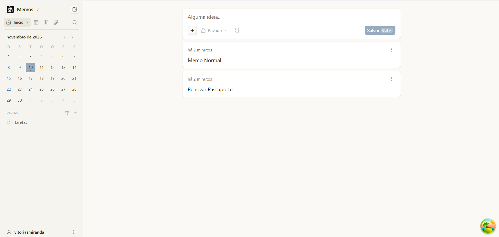
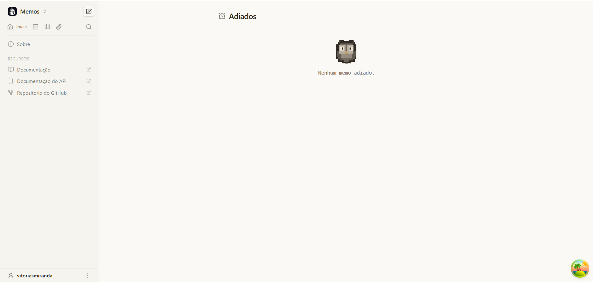

# 7. Implementação experimental: adiar um memo até uma data

Implementação da evolução proposta em [`05-evolucao/proposta.md`](../05-evolucao/proposta.md), baseada na [issue #6388](https://github.com/usememos/memos/issues/6388) do Memos.

## Repositório, branches e pull requests

- **Fork:** [vitoriasmiranda/memos](https://github.com/vitoriasmiranda/memos)
- **Base:** branch [`tp-base`](https://github.com/vitoriasmiranda/memos/tree/tp-base), igual à tag `v0.31.0` analisada no trabalho
- Commits em inglês, no padrão de commits convencionais usado pelo projeto (seção 2.4 do processo)

| PR | Branch | Autor | Revisor | Conteúdo |
|----|--------|-------|---------|----------|
| [#1](https://github.com/vitoriasmiranda/memos/pull/1) | `feat/hide-until-frontend` | Vitória | Vanderson | Botão de adiar no editor, seletor de data e hora, textos nos idiomas, testes das funções de data |
| [#3](https://github.com/vitoriasmiranda/memos/pull/3) | `feat/hide-until-backend` | Vanderson | Vitória | Campo `hide_until` na API e no banco, regra que esconde o memo da linha do tempo, envio da data pelo editor, selo "Adiado até", testes |
| [#2](https://github.com/vitoriasmiranda/memos/pull/2) | `feat/postponed-page` | Vitória | Vanderson | Opção `hidden_only` na API e no banco e página "Adiados" |

Os PRs foram integrados nesta ordem: #1 → #3 → #2, porque cada branch foi criada a partir da anterior.

## Revisão

Cada PR foi revisado e aprovado pelo outro integrante antes do merge, feito com *merge commit* para manter o histórico de cada um. Todos foram integrados na `tp-base` em 10/11/2026.

| PR | Revisor | Resultado |
|----|---------|-----------|
| [#1](https://github.com/vitoriasmiranda/memos/pull/1) (front do adiamento) | Vanderson | Aprovado |
| [#3](https://github.com/vitoriasmiranda/memos/pull/3) (back do adiamento) | Vitória | Aprovado, após teste local |
| [#2](https://github.com/vitoriasmiranda/memos/pull/2) (página "Adiados") | Vanderson | Aprovado |

Comentário de revisão no PR #1 (Vanderson):

> Revisei o seletor de data, a integração com o estado do editor, as funções auxiliares e os testes. A validação das datas e o bloqueio do recurso em comentários estão adequados. Aprovado.

Comentário de revisão no PR #2 (Vanderson):

> Revisei o contrato Protobuf, a restrição por usuário e os filtros dos bancos. A implementação está coerente com a proposta e possui testes cobrindo o comportamento principal.

Comentário de revisão no PR #3 (Vitória):

> Testei localmente junto com a minha branch: ao adiar, o memo some da linha do tempo, o selo "Adiado até" aparece e ele volta sozinho depois da data. Os testes do back passam no SQLite. Gostei que o filtro roda no banco nos três drivers, mantendo a paginação correta, e que o memo continua acessível pelo link. Aprovado.

Como as branches foram criadas uma em cima da outra, o PR #2 apontou primeiro para a branch do back (`feat/hide-until-backend`), para mostrar só os commits da página durante a revisão, e teve a base trocada para `tp-base` depois do merge do #3.

## O que foi implementado

**Adiar um memo.** No editor, um botão com ícone de relógio, ao lado do seletor de visibilidade, abre um seletor de data e hora. Enquanto a data não chega, o memo não aparece na linha do tempo; quando ela passa, ele volta sozinho. A comparação com o horário atual é feita no banco a cada consulta, então não existe tarefa agendada no servidor.

**Página "Adiados".** Durante a implementação, percebemos que a busca e a página de Arquivados usam a mesma listagem da linha do tempo, então um memo adiado ficava inacessível até a data chegar. Para resolver, criamos a página "Adiados" (menu do avatar, abaixo de Arquivados), que lista só os memos do próprio usuário que ainda estão adiados. Dali ele pode abrir o memo e mudar ou limpar a data.

### Principais arquivos

| Camada | Arquivos |
|--------|----------|
| Contrato da API | `proto/api/v1/memo_service.proto` (campo `hide_until` em `Memo` e opção `hidden_only` em `ListMemosRequest`) |
| Banco | `proto/store/memo.proto` (data guardada no `payload` JSON, sem migração), `store/memo.go`, `store/db/{sqlite,mysql,postgres}/memo.go` |
| Servidor | `server/api/v1/memo_service.go`, `memo_create_helpers.go`, `memo_service_converter.go` |
| Editor | `web/src/components/MemoEditor/Toolbar/HideUntilSelector.tsx`, `utils/hideUntil.ts`, `state/types.ts`, `services/memoService.ts` |
| Exibição | `web/src/components/MemoView/components/MemoHideUntilBadge.tsx` |
| Página | `web/src/pages/Postponed.tsx`, `web/src/router/`, `web/src/components/UserMenu.tsx`, `web/src/components/PagedMemoList/PagedMemoList.tsx` |
| Textos | `web/src/locales/*.json` (44 idiomas; pt-BR traduzido) |

### Reuso

- O seletor de data usa os componentes `Button` e `Popover` do próprio Memos e o ícone da biblioteca `lucide-react`.
- A página "Adiados" segue a página de Arquivados e reaproveita o `PagedMemoList`, que já faz a listagem com rolagem infinita.
- As ferramentas MCP passam a expor o campo novo sem mudança manual, porque são geradas do `openapi.yaml` (PR #6026 do projeto).

## Telas

Teste manual feito em 10/11/2026, com o Memos rodando localmente na branch `feat/postponed-page` e a interface em português. O memo "Renovar Passaporte" foi adiado até 11:33 do mesmo dia.

**1. Seletor "Adiar até" no editor**



**2. Depois de salvar, o memo adiado some da linha do tempo**



**3. Um memo normal, criado em seguida, aparece; o adiado continua oculto**



**4. Item "Adiados" no menu do usuário, abaixo de "Arquivo"**



**5. Página "Adiados", com o selo da data**



**6. Depois das 11:33, o memo volta sozinho para a linha do tempo**



**7. A página "Adiados" fica vazia, porque o memo já voltou**



## Testes e evidências

### Back (Go)

| Teste | O que verifica | Resultado |
|-------|----------------|-----------|
| `TestMemoHideUntilLifecycle` | Criar memo adiado, sumir da listagem, abrir pelo link, remover a data e voltar a aparecer | ✅ passou |
| `TestMemoHideUntilRejectsInvalidTimestamp` | Data inválida é recusada | ✅ passou |
| `TestListMemosHiddenOnly` | Página "Adiados": o dono vê só o memo adiado; outro usuário não vê nada | ✅ passou |
| `TestMemoListExcludesFutureHidden` | Banco: a listagem normal esconde só os adiados com data futura | ✅ passou |
| `TestMemoListOnlyFutureHidden` | Banco: a opção `hidden_only` traz só os adiados com data futura | ✅ passou |

Comandos usados (no Windows, os testes de MySQL e PostgreSQL precisam de Docker, então rodamos no SQLite):

```bash
go test ./server/api/v1/test/ -run "HideUntil|HiddenOnly" -v
DRIVER=sqlite go test ./store/test/ -run "FutureHidden" -v
```

### Front (TypeScript)

| Arquivo de teste | O que verifica | Resultado |
|------------------|----------------|-----------|
| `web/tests/memo-editor-hide-until.test.ts` | Conversão de datas, rejeição de datas impossíveis, "ainda está adiado?" | ✅ 4 passaram |
| `web/tests/memo-editor-hide-until-service.test.ts` | Envio da data ao criar, ao editar e ao remover | ✅ 3 passaram |
| `web/tests/postponed-page.test.tsx` | A página pede só os adiados e mostra o título certo | ✅ 1 passou |
| `web/tests/locale-resources.test.ts` | Todos os 44 idiomas têm os textos novos | ✅ passou |

Verificações do projeto também passaram: `pnpm lint` (TypeScript + Biome) e `gofmt`.

> Três testes de `web/tests/filtered-memo-stats.test.ts` falham, mas já falhavam na `v0.31.0` original, antes de qualquer mudança nossa.

## Como executar

Requisitos: Go 1.27, Node 24 e pnpm.

```bash
git clone https://github.com/vitoriasmiranda/memos
cd memos
git checkout tp-base

# servidor (porta 8081)
go run ./cmd/memos --port 8081

# em outro terminal: interface (abre em http://localhost:3001)
cd web
pnpm install
pnpm dev
```

Para testar: crie um memo, clique no relógio, escolha uma data alguns minutos à frente e salve. O memo some da linha do tempo e aparece em **Avatar → Adiados**. Quando a data passar, ele volta para a linha do tempo.

## Limitações e próximos passos

- **Sem notificação:** o memo volta para a linha do tempo, mas o usuário não recebe aviso (e-mail ou push). Isso exigiria uma tarefa agendada no servidor e configuração de SMTP.
- **Exportação:** o formato de exportação em ZIP ainda não inclui `hide_until`, então um memo adiado volta visível ao ser importado em outra instância.
- **Versão:** a implementação parte da `v0.31.0`. Para virar uma contribuição real ao Memos, teria de ser adaptada à versão atual e discutida na issue #6388 com os mantenedores.